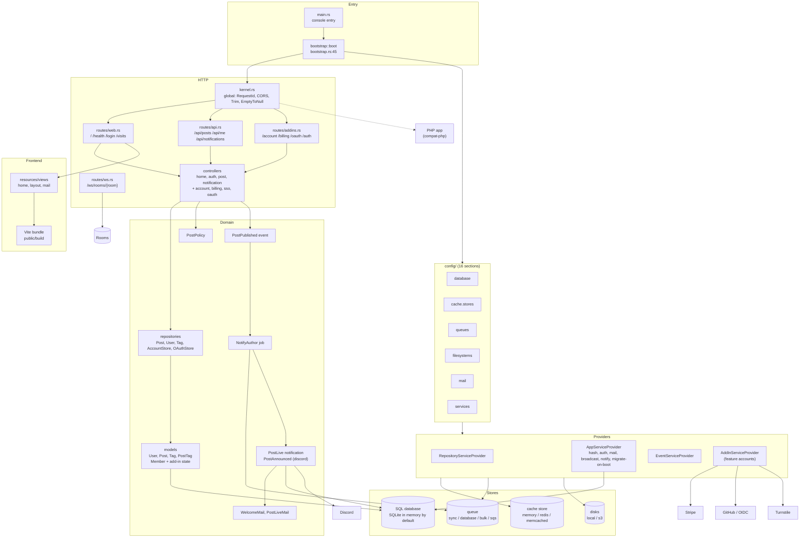

# rainier-sample-project: feature docs

> **Last verified against code:** 2026-11-06 @ `741ad28` (framework pinned at `ad4f199`, `Cargo.toml:13`)

The starter and reference application for the in-house [Rainier] framework: a
small blog (users, posts, tags) with a JSON API, one server-rendered page, a
queued notification chain, a WebSocket room, and every optional framework
piece wired behind a cargo feature of the same name. Nobody runs it in
production. It is cloned to start a new service, and its code reaches
lewd-backend, maps-api, billing-api and bdsm-org that way (`src/bootstrap.rs:561`).
A bug here therefore tends to show up in every service started from it.

It deploys nothing. `.github/workflows/ci.yml` runs fmt, clippy, a feature
test matrix, a migrations round-trip, a boot check and a Docker build on every
push to `main` and weekly (`ci.yml:3-10`). There is no deploy job.

These docs cover what this application contains and how it uses the
framework. The framework itself is documented in
[rainier-framework/docs][fw]. Where a section would only re-explain the
framework, it links there.

[Rainier]: https://github.com/safewords/rainier-framework
[fw]: https://github.com/safewords/rainier-framework/blob/main/docs/README.md

## Index

| Component | Status | Doc |
|---|---|---|
| Boot, configuration and feature sizing | STABLE | [boot-and-configuration.md](boot-and-configuration.md) |
| Routes, middleware and controllers | STABLE | [routes-and-controllers.md](routes-and-controllers.md) |
| Models and migrations | PARTIAL | [models-and-migrations.md](models-and-migrations.md) |
| Authentication and authorisation (API) | PARTIAL | [auth.md](auth.md) |
| Events, queues, jobs and the schedule | STABLE | [queues-and-jobs.md](queues-and-jobs.md) |
| Cache and session drivers | STABLE | [cache-and-sessions.md](cache-and-sessions.md) |
| Mail and notifications | STABLE | [mail-and-notifications.md](mail-and-notifications.md) |
| Broadcasting and WebSockets | PARTIAL | [realtime.md](realtime.md) |
| File storage | PARTIAL | [storage.md](storage.md) |
| Console commands | STABLE | [console-commands.md](console-commands.md) |
| Frontend: views and Vite | STABLE | [frontend-vite.md](frontend-vite.md) |
| Docker image and CI matrix | PARTIAL | [docker-and-ci.md](docker-and-ci.md) |
| Add-ins (accounts, 2FA, passkeys, SSO, billing, OAuth server, telemetry, captcha, Discord) | STABLE | [add-ins.md](add-ins.md) |
| compat-php (running beside a PHP application) | STABLE | [compat-php.md](compat-php.md) |

New docs start from [`_TEMPLATE.md`](_TEMPLATE.md).
The standard these follow is `docs/feature-docs.md` in the devenv repository.

## Cargo features

A default build has none of these. Each one forwards to the framework feature
with the same name (`Cargo.toml:41-140`). `cargo rainier features --env <file>`
works out the list from a deployment's environment file (README "Sizing the
binary").

| Feature | Turns on | Wired in this app at | Covered by CI matrix (`ci.yml:81-90`) |
|---|---|---|---|
| `redis` | Redis cache store client | `config/cache.rs:142-154` (`REDIS_URL`, `SESSION_REDIS_URL`) | yes |
| `redis-cluster` | Redis Cluster (implies `redis`) | same stores | yes |
| `memcached` | Memcached store | `config/cache.rs:164-168` (`MEMCACHED_URL`) | yes |
| `sqs` | SQS queue connection | `config/queue.rs:133-157` (`SQS_QUEUE_URL`) | no |
| `kafka`, `kafka-tls` | Kafka client | nothing; deliberately no queue connection (`config/queue.rs:158-169`) | no |
| `s3` | S3-API disks | `config/storage.rs:59-118` (`STORAGE_BUCKET`, `ARCHIVE_*`) | no |
| `bcrypt` | `HASH_DRIVER=bcrypt`, reading `$2y$` hashes | `config/hashing.rs:21` | no |
| `jwt` | RS256/ES256 + JWKS API surface | not used by app code | no |
| `http-client` | a real transport behind the `Http` facade | not used by app code; add-ins use `ReqwestTransport` (`providers/outbound.rs:36`) | no |
| `mail-smtp` … `mail-resend` | one mail sender each | `config/mail.rs:38-75` (`MAIL_DRIVER`) | no |
| `add-ins` | every add-in except `compat-php` | [add-ins.md](add-ins.md) | yes |
| `compat-php` | PHP session/CSRF interop (implies `accounts`) | [compat-php.md](compat-php.md) | yes |

## Known defects

Found while writing these docs at `741ad28`. None is fixed here, because this
commit is documentation only.

| Component | Defect | Severity |
|---|---|---|
| realtime | `Chat::authorize` accepts any `Authorization: Bearer <anything>`. It checks the prefix and never validates the token (`routes/ws.rs:40-42`), so anybody can join any room. Services cloned from this template inherit it | High |
| docker-and-ci | `HEALTHCHECK` runs `app route:list`, not `/health` (`Dockerfile:188-189`), although the comment above it describes `/health`. Each probe boots the whole application, which connects to the database and runs pending migrations (`app_provider.rs:65-87`). It never checks that the server is answering | Medium |
| boot-and-configuration | README quick start runs `app:seed` and then `serve` as two processes against the default `DATABASE_URL=sqlite::memory:` (`README.md:11-12`, `.env.example`), so the seeded data is gone before the server starts | Medium |
| queues-and-jobs | README says the default queue is `MemoryQueue` and tells you to switch to `DatabaseQueue` in `app_provider.rs` (`README.md:111-114`). Running mode uses `config/queue.rs` with `QUEUE_CONNECTION=sync` by default (`bootstrap.rs:185`, `config/queue.rs:103`). The `README.md:161` table and `jobs/mod.rs:3-4` (which names a `queue_provider.rs` that does not exist) are stale in the same way. The registry is at `bootstrap.rs:172` | Low |
| boot-and-configuration | Every process except `migrate*` migrates on boot (`app_provider.rs:65-87`). That includes `serve`, `queue:work`, `schedule:run` and the Docker healthcheck, so replicas starting together race on the migrator | Medium |
| models-and-migrations | `0004_add_post_search` builds a full-text index on every dialect (on SQLite, an FTS5 table nothing populates). Search is `LIKE '%term%'` on `title` only (`post_repository.rs:71-73`), so the index is never used and the body is never searched | Low |
| models-and-migrations | `posts.author_id` has three single-column or leading indexes: `idx_posts_author_id` from the model (`post.rs:69`), `posts_author_id_index` from `m0003`, and the composites `author_id, deleted_at` (`post.rs:44`) and `author_id, created_at` (`m0008`) | Low |
| models-and-migrations | `migrations/mod.rs:14` says `m0003` is "raw SQL". It uses the builder (`m0003_index_posts_author.rs:14-18`) | Low |
| auth | The API token is stored in plain text in `users.api_token` (`auth_controller.rs:27-29`, `user.rs:33`), so anyone who can read the database holds every live token | Medium |
| auth | Emails are not lowercased when written or looked up (`user_repository.rs:21-23`, `providers/mod.rs:41-42`), although `m0005` normalises existing rows. Login is case-sensitive on SQLite and Postgres | Low |
| routes-and-controllers | `ListPostsRequest` hard-codes 15 per page and a maximum of 100 (`requests/login.rs:46-56`). `POSTS_PER_PAGE` is configured (`config/posts.rs:11`) but nothing reads it | Low |
| routes-and-controllers | CORS always allows `http://localhost:5173` and `:4173` with credentials, production included (`config/cors.rs:90-110`) | Low |
| routes-and-controllers | `routes/mod.rs:5` says `api` gets CORS. CORS is global (`kernel.rs:89`) | Low |
| add-ins | The Discord announcement links to `{APP_URL}/posts/{slug}` (`app_provider.rs:329`). No such web route exists, only `/api/posts/{post}` | Low |
| frontend-vite | README describes an `asset_controller` serving `/build` (`README.md:303`). It was deleted, and the framework now serves `public/` (`routes/web.rs:12-24`). `resources/views/posts/show.view.html` is not rendered by any route | Low |
| realtime | In Running mode broadcasts go to `Broadcasting::log()` (`app_provider.rs:217`). Nothing reaches a browser until somebody wires a real broadcaster | Low (documented in code) |
| queues-and-jobs | The scheduled `sessions:prune` always queries the database session table (`routes/console.rs:44-55`), which is never migrated (`migrations/mod.rs:104-106`), so it fails every hour under `schedule:run` | Low |
| docker-and-ci | The CI matrix never builds `sqs`, `kafka`, `s3`, `bcrypt`, `jwt`, `http-client` or any `mail-*` feature (`ci.yml:81-90`) | Low |
