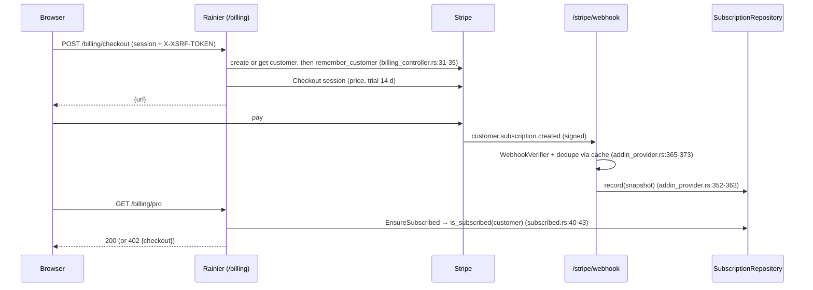

# Add-ins

> **Status:** STABLE
> **Owners (code):** `src/app/providers/addin_provider.rs`, `src/routes/addins.rs`, `src/config/services.rs`, `src/app/providers/outbound.rs`, `src/app/http/controllers/{account,billing,sso,oauth}_controller.rs`, `src/app/http/middleware/subscribed.rs`, `src/app/models/{member,account_state,oauth}.rs`, `src/app/repositories/{account_store,oauth_store,subscription_repository}.rs`, `tests/addins.rs`
> **Related docs:** [compat-php.md](compat-php.md), [auth.md](auth.md), [models-and-migrations.md](models-and-migrations.md); framework: [add-ins], [accounts], [two-factor], [sso], [billing], [oauth-server], [captcha], [observability]
> **Last verified against code:** 2026-11-06 @ `741ad28`

[add-ins]: https://github.com/safewords/rainier-framework/blob/main/docs/add-ins.md
[accounts]: https://github.com/safewords/rainier-framework/blob/main/docs/accounts.md
[two-factor]: https://github.com/safewords/rainier-framework/blob/main/docs/two-factor.md
[sso]: https://github.com/safewords/rainier-framework/blob/main/docs/sso.md
[billing]: https://github.com/safewords/rainier-framework/blob/main/docs/billing.md
[oauth-server]: https://github.com/safewords/rainier-framework/blob/main/docs/oauth-server.md
[captcha]: https://github.com/safewords/rainier-framework/blob/main/docs/captcha.md
[observability]: https://github.com/safewords/rainier-framework/blob/main/docs/observability.md

## Overview

These are the framework's optional browser-facing pieces. Each one is wired
here behind a cargo feature of the same name, and none is on by default. The
`add-ins` feature turns on all of them except `compat-php`
(`Cargo.toml:127-137`). Everything after `accounts` depends on it, because
checkout, social sign-in, the consent screen and impersonation all rely on
the browser session and its `web` guard over `Member` (`Cargo.toml:96-125`).

The add-ins are assembled in `AddIns::build`, which runs in `bootstrap.rs`
before the builder (`bootstrap.rs:85-95`). Their routes are declared while
the router is being built, and a provider registers too late for that. The
assembled bundle is handed to `AddInServiceProvider`, which binds it
(`addin_provider.rs:509-524`).

## How it works today

### Data model

All the add-in tables are created in every build by migrations `0009`-`0018`.
See [models-and-migrations.md](models-and-migrations.md#data-model).
`AccountStore` loads a `User` together with what the add-ins know about it
(`email_verified_at`, `stripe_customer_id`) into a `Member`
(`account_store.rs:70-104`). It also implements the framework ports
`AccountUsers`, `CreatesNewUsers`, `UserProvider`, `TwoFactorUsers`,
`PasskeyRepository` and `SocialAccounts` (`account_store.rs:112-419`).
Two-factor secrets are encrypted with `APP_KEY` before they are stored
(`tests/addins.rs:345`).

### Interfaces

| Feature | Routes | Middleware | Env | Source |
|---|---|---|---|---|
| `accounts` | the framework's `/account/*` flows (login with lockout, logout, password reset, email verification, confirmation, change); `GET /account/csrf`; `POST /account/register` (10/min); `GET /account` (verified only); `POST /admin/impersonate/{user}`, `POST /admin/impersonate/leave` | `browser()` = web + CSRF; `web_auth()`; `EnsureEmailIsVerified` | `APP_URL`, `ADMIN_EMAILS` | `routes/addins.rs:35-77`, `addin_provider.rs:152-179` |
| `two-factor` | TOTP enrolment, recovery codes, the challenge | the account routes | none | `addin_provider.rs:181-187` |
| `passkeys` | passkey registration and sign-in | the account routes | `APP_URL` (relying party host and origin) | `addin_provider.rs:188-198` |
| `sso` | `GET /auth/{provider}/redirect`, `/callback` | browser | `GITHUB_CLIENT_ID/SECRET`, `OIDC_NAME/ISSUER/CLIENT_ID/CLIENT_SECRET` | `routes/addins.rs:55-61`, `addin_provider.rs:279-316` |
| `billing-stripe` | `POST /billing/checkout` (14-day trial, promo codes), `POST /billing/portal`, `GET /billing/pro`, `POST /stripe/webhook` | `ForbidImpersonation` on checkout and portal; `EnsureSubscribed` (402) on pro | `STRIPE_SECRET`, `STRIPE_WEBHOOK_SECRET`, `STRIPE_PRICE` | `routes/addins.rs:79-116`, `addin_provider.rs:320-385`, `billing_controller.rs:26-69` |
| `oauth-server` | `GET/POST /oauth/authorize` (consent), `POST /oauth/token`, `POST /oauth/revoke`, `GET /api/v1/me` | `api(None)` + `Authenticate::<User>("oauth")` + `RequireAbility(["account"])` | `OAUTH_PRIVATE_KEY` (PEM or a path) | `routes/addins.rs:100-142`, `addin_provider.rs:391-450` |
| `telemetry` | none | `Trace` global (`kernel.rs:56-58`) | `TELEMETRY_ENABLED`, `OTEL_*` | `bootstrap.rs:101-116` |
| `captcha` | none (Turnstile in front of register, action `register`) | `RequireCaptcha` | `CAPTCHA_SECRET`, `CAPTCHA_HOSTNAME` | `routes/addins.rs:50-53`, `addin_provider.rs:245-272` |
| `notify-discord` | none (a `PostPublished` listener) | none | `DISCORD_WEBHOOK_URL`, `APP_URL` | `app_provider.rs:320-341`, `notifications/post_announced.rs` |

### Flow

Impersonation is allowed when the staff member's email is in `ADMIN_EMAILS`
and the target's is not. Taking it and leaving it both log at `warn`
(`addin_provider.rs:200-209`).

Third-party calls (Stripe, GitHub/OIDC, Turnstile, Discord) all go through
one `Outbound` transport. It is a `ReqwestTransport` in Running mode and a
`FakeTransport` under test, so `tests/addins.rs` can queue up a provider's
replies (`providers/outbound.rs:31-45`).

### Configuration

`config/services.rs:103-144` reads every value. `Services::check` stops a
production boot when `STRIPE_SECRET` is set and `STRIPE_WEBHOOK_SECRET` is
not (`services.rs:165-176`). Other missing settings are reported once boot
has finished, as warnings collected in `AddIns.notices`
(`bootstrap.rs:276-279`):

| Missing | Effect |
|---|---|
| `STRIPE_SECRET` | billing disabled; the controllers answer 404 and `/billing/pro` answers 402 |
| `STRIPE_WEBHOOK_SECRET` (non-production) | `/stripe/webhook` not mounted; subscriptions never update |
| `CAPTCHA_SECRET` | registration is not checked |
| `OAUTH_PRIVATE_KEY` | outside production: a per-process key, so every token dies on restart. In production: **boot failure** (`addin_provider.rs:417-431`) |
| `DISCORD_WEBHOOK_URL` | the listener returns without sending |

### Edge cases & gotchas

- **The Discord link 404s.** The announcement points to
  `{APP_URL}/posts/{slug}` (`app_provider.rs:329`), and no such web route
  exists.
- **`production` means `APP_ENV == "production"` exactly**
  (`services.rs:109`). `APP_ENV=prod` skips the Stripe check and lets the
  OAuth server sign with a throwaway key.
- **The add-ins have their own `HashManager`, `Dispatcher` and key ring**,
  separate from the container's (`addin_provider.rs:135-148`). Stripe events
  go to `AddIns.events` and never reach `EventServiceProvider`'s listeners.
- **Cross-origin front ends.** `X-XSRF-TOKEN` is not in the CORS
  allow-list (`config/cors.rs:100`).
- **`registration: false`** in `Features` is intentional. The app mounts
  `/account/register` itself so the captcha can wrap it
  (`addin_provider.rs:158-161`).

## History & references

- README "Add-ins".
- Tests: `tests/addins.rs` (23 tests, one module per feature, `:113-807`), run by the `add-ins` CI matrix entry.

## Proposed / Ideas (backlog)

| Idea | Motivation | Sketch | Status |
|---|---|---|---|
| Point Discord at a real page | The link 404s | Use `Url::absolute("api.posts.show")`, or add a web post page | Open |
| Treat any non-dev `APP_ENV` as production | `prod`/`staging` slip past the checks | Use `AppEnv` from config in place of the string compare | Open |
