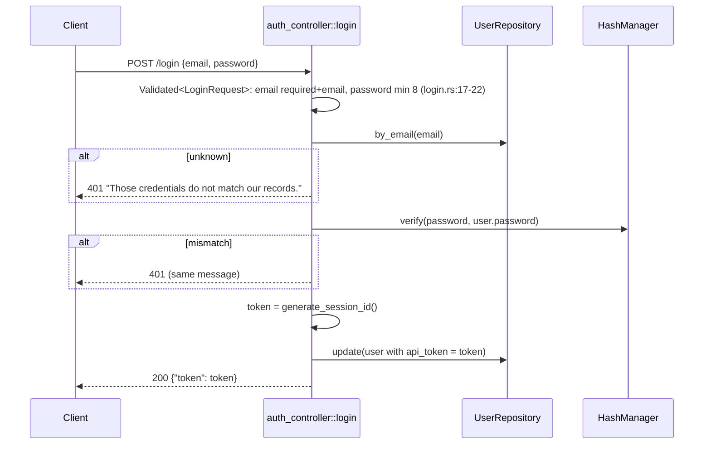

# Authentication and authorisation (API)

> **Status:** PARTIAL — works and is tested; tokens are stored in plain text and email matching is case-sensitive
> **Owners (code):** `src/app/http/controllers/auth_controller.rs`, `src/app/providers/app_provider.rs` (`hashing`, `authentication`), `src/app/http/kernel.rs` (`auth`), `src/app/policies/post_policy.rs`, `src/app/models/user.rs`
> **Related docs:** [add-ins.md](add-ins.md) (browser sessions, the `web` guard, OAuth tokens), [cache-and-sessions.md](cache-and-sessions.md); framework: [authentication], [authorization], [hashing], [encryption]
> **Last verified against code:** 2026-11-06 @ `fd84ed4`

[authentication]: https://github.com/safewords/rainier-framework/blob/main/docs/authentication.md
[authorization]: https://github.com/safewords/rainier-framework/blob/main/docs/authorization.md
[hashing]: https://github.com/safewords/rainier-framework/blob/main/docs/hashing.md
[encryption]: https://github.com/safewords/rainier-framework/blob/main/docs/encryption.md

## Overview

The JSON API uses bearer tokens. `POST /login` swaps an email and password
for a random token, which is stored on the `users` row. The `api` guard looks
that token up on every guarded request. One policy, `PostPolicy`, decides who
may change a post. Browser sessions (the `web` guard on `Member`) and OAuth
access tokens (the `oauth` guard) belong to the add-ins, covered in
[add-ins.md](add-ins.md).

## How it works today

### Data model

`users.password` holds an argon2id hash by default (`config/hashing.rs:21`).
`users.api_token` is nullable and indexed (`models/user.rs:27-33`), and the
token is stored in plain text. Neither column is ever serialised
(`user.rs:110-117`).

### Interfaces

| Kind | Name / path | Auth | Handler | Notes |
|---|---|---|---|---|
| HTTP | `POST /login` | none (web group, 10/min) | `auth_controller::login` (`:14-32`) | `{"token": "…"}`, and one 401 message for every failure |
| HTTP | `GET /api/me` | `api` guard | `auth_controller::me` (`:49-51`) | the `User` JSON |
| HTTP | `POST /api/logout` | `api` guard | `auth_controller::logout` (`:35-46`) | sets `api_token = NULL`, 204 |
| Guard | `api` | `TokenGuard` over `RepositoryUserProvider<User>` | `app_provider.rs:128-159` | default guard of `AuthManager<User>` |
| Guard | `oauth` | `OAuthGuard` (feature `oauth-server`) | `app_provider.rs:145-156` | see [add-ins.md](add-ins.md) |
| Policy | `posts.update` / `posts.publish` / `posts.delete` | author only | `post_policy.rs:19-35` | `posts.create` allows anyone authenticated; undefined abilities are denied |
| Env | `HASH_DRIVER` | | `config/hashing.rs:21` | `argon2id` (default); `bcrypt` needs the cargo feature |
| Env | `APP_KEY`, `APP_PREVIOUS_KEYS`, `APP_CIPHER` | | `config/app.rs:18` | `Crypt` facade; `key:generate` prints one |

### Flow

A guarded request reaches `Authenticate::<User>` with the `api` guard
(`kernel.rs:280-282`), which puts an `AuthenticatedUser<User>` on the
request. Handlers take it as an extractor. Without the middleware the
extractor returns 401, never a panic (`post_controller.rs:228-238`).
`FormRequest::authorize` makes the same check again in the request contracts
(`store_post.rs:40-42`).

The policy is a `Gate<User>` built on each call. Ownership is
`post.author_id == user.id` (`post.rs:130-132`), and a denial is a 403
(`post_policy.rs:58-65`).

Under test the hasher is `HashManager::insecure_for_tests`
(`app_provider.rs:115-125`), so each feature test does not spend its time
on argon2.

### Configuration

`HASH_DRIVER`, `APP_KEY`. With no `APP_KEY` a random key is generated on each
boot, and whatever the previous boot encrypted can no longer be read (README
"Sessions and encryption").

### Edge cases & gotchas

- **Tokens are stored in plain text.** Anyone with read access to the
  database, or to a backup, can act as every logged-in user. Each login
  replaces the token, so a user has one live token at a time.
- **Email lookup is exact.** `by_email` compares as-is
  (`user_repository.rs:21-23`). `register_user` stores the address as given
  (`providers/mod.rs:41-42`). `m0005` lowercased the existing rows once, and
  nothing keeps them lowercase. `Ada@Example.com` fails to log in on SQLite
  and Postgres.
- **One 401 for every failure**, so the endpoint does not reveal which
  addresses are registered (`auth_controller.rs:18-20`, test
  `tests/feature.rs:196`). The timing still differs: an unknown address
  skips the hash check.
- `logout` clones the shared `Arc<User>` before writing (`auth_controller.rs:38-43`).

## History & references

- Tests: `tests/feature.rs:190-245` (login, guard, logout), `:728` (policy).

## Proposed / Ideas (backlog)

| Idea | Motivation | Sketch | Status |
|---|---|---|---|
| Store a hash of the token | A database read currently exposes every live token | Store `sha256(token)` and look up by hash | Open |
| Normalise email on write and on lookup | Case-sensitive login | Lowercase in `LoginRequest`/`register_user`, or a `lower()` comparison | Open |
