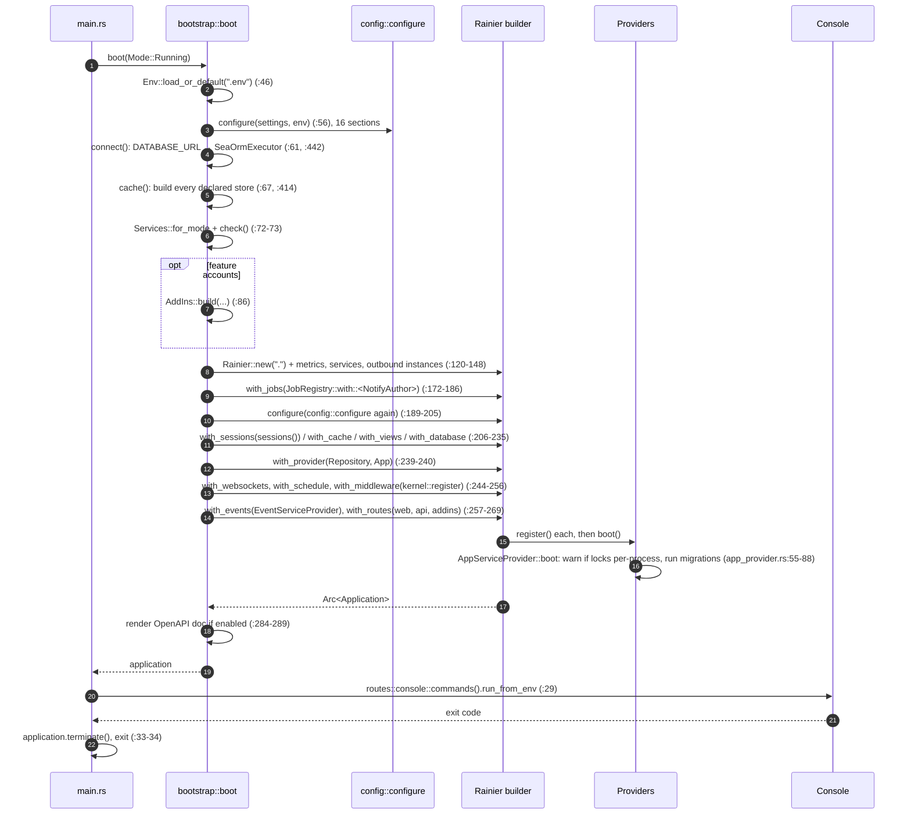

# Boot, configuration and feature sizing

> **Status:** STABLE
> **Owners (code):** `src/main.rs`, `src/bootstrap.rs`, `src/config/`, `src/app/providers/app_provider.rs`, `src/app/providers/repository_provider.rs`
> **Related docs:** [routes-and-controllers.md](routes-and-controllers.md), [cache-and-sessions.md](cache-and-sessions.md), [docker-and-ci.md](docker-and-ci.md); framework: [lifecycle], [configuration], [providers], [container]
> **Last verified against code:** 2026-11-06 @ `741ad28`

[lifecycle]: https://github.com/safewords/rainier-framework/blob/main/docs/lifecycle.md
[configuration]: https://github.com/safewords/rainier-framework/blob/main/docs/configuration.md
[providers]: https://github.com/safewords/rainier-framework/blob/main/docs/providers.md
[container]: https://github.com/safewords/rainier-framework/blob/main/docs/container.md
[deployment]: https://github.com/safewords/rainier-framework/blob/main/docs/deployment.md

## Overview

There is one binary, `app`, and every process runs through it. `main.rs`
boots the application and then hands `argv` to the console kernel
(`main.rs:21-34`), so `serve`, `queue:work`, `migrate` and `app:seed` are all
console commands run on the same assembled application. Assembly happens once,
in `bootstrap::boot` (`bootstrap.rs:45`). It takes a `Mode`: `Running` for a
real process, `Testing` for the feature tests, which want captured mail, an
in-memory queue and no global tracing subscriber (`bootstrap.rs:35-42`).

## How it works today

### Boot sequence

If boot fails, `main` prints the error's message (not its `Debug` form) and
exits 1 (`main.rs:21-27`).

### Configuration

`config::configure` calls one module per concern, in a fixed order
(`config/mod.rs:103-122`). Each module writes typed `Key<T>` values or a whole
framework section. The four sections (`databases`, `cache.stores`, `queues`,
`filesystems`) declare every backend by name, and the framework builds each
one ([configuration]).

| Module | Declares | Key env vars |
|---|---|---|
| `app.rs` | name, locale, cipher; validates `APP_ENV` (`:10-31`) | `APP_NAME`, `APP_LOCALE`, `APP_CIPHER`, `APP_ENV` |
| `database.rs` | `primary` (SQLite file or memory) and an optional MySQL `reporting` connection (`:65-175`) | `DATABASE_URL` wins over everything; `DB_DATABASE`, `REPORTING_DB_*` |
| `session.rs` | driver, cookie, lifetime, secure, SameSite=lax (`:11-37`) | `SESSION_*` |
| `cache.rs` | stores `memory`, `shared`, `sessions`, `memcached` ([cache-and-sessions.md](cache-and-sessions.md)) | `CACHE_STORE`, `REDIS_URL`, `SESSION_REDIS_URL`, `MEMCACHED_URL` |
| `queue.rs` | connections `sync`, `database`, `bulk`, optional `sqs` ([queues-and-jobs.md](queues-and-jobs.md)) | `QUEUE_CONNECTION`, `SQS_*` |
| `hashing.rs` | argon2id by default (`:21`) | `HASH_DRIVER` |
| `mail.rs` | driver and every transport's settings ([mail-and-notifications.md](mail-and-notifications.md)) | `MAIL_*` |
| `storage.rs` | disks `uploads`, `documents`, `archive` ([storage.md](storage.md)) | `FILESYSTEM_DISK`, `STORAGE_*`, `ARCHIVE_*` |
| `kafka.rs` | brokers, group, prefix, TLS/SASL (`:16-31`) | `KAFKA_*` |
| `posts.rs` | `posts.per_page`, `posts.max_per_page` (`:9-19`) | `POSTS_PER_PAGE` |
| `cors.rs` | allowed origins ([routes-and-controllers.md](routes-and-controllers.md)) | `CORS_ALLOWED_ORIGINS` |
| `server.rs` | request timeout 30 s, compression off (`:13-35`) | `SERVER_REQUEST_TIMEOUT`, `SERVER_COMPRESSION` |
| `metrics.rs`, `openapi.rs`, `telemetry.rs` | Prometheus, the OpenAPI document, OTLP, all off by default | `METRICS_ENABLED`, `OPENAPI_ENABLED`, `TELEMETRY_ENABLED`, `OTEL_*` |
| `services.rs` | add-in credentials, admin list, `production` flag (`:103-144`) | see [add-ins.md](add-ins.md) |

`configure` runs twice: once on a scratch `Config` before the builder, because
the observability settings and the cache have to exist before middleware is
declared (`bootstrap.rs:55-56`), and again inside `.configure(...)` on the
framework's tree (`bootstrap.rs:192`). An error the second time is only
logged, but any error would already have failed the first call.

### Providers

| Provider | Registers | Source |
|---|---|---|
| `RepositoryServiceProvider` | `PostRepository` (with the event dispatcher), `UserRepository`, `EntityRepository<Tag>`, `TagRepository`, all singletons | `repository_provider.rs:26-57` |
| `AppServiceProvider` | `HashManager`, `AuthManager<User>` (`api` token guard, plus `oauth` under `oauth-server`), `Mailer`, broadcasting and the channel table, `DatabaseChannel` and `Notifier`, the `Migrator` | `app_provider.rs:43-53` |
| `EventServiceProvider` | `PostPublished` listeners (a function, not a `ServiceProvider`) | `app_provider.rs:287-343` |
| `AddInServiceProvider` | `AuthManager<Member>`, `AccountStore`, `AddIns` (feature `accounts`) | `addin_provider.rs:509-524` |

`AppServiceProvider::boot` runs pending migrations on every boot except the
`migrate*` commands (`app_provider.rs:65-87`, `:98-100`). Before that it warns
when the lock manager is per-process (`:72-77`).

### Feature sizing

A build compiles only the drivers it names as cargo features
(`Cargo.toml:41-140`). The app has no build script and no tool of its own. The
Dockerfile installs `cargo-rainier` at the framework revision the lockfile
pins, and sizes the build from `.env.build` (`Dockerfile:79-125`). Picking a
driver the build lacks fails the boot. It never falls back
(`Cargo.toml:31-40`, `bootstrap.rs:394-422`). The feature matrix is in the
[README](README.md#cargo-features), and the mechanism is covered by the
framework's [deployment] doc.

### Edge cases & gotchas

- **`DATABASE_URL=sqlite::memory:` lives as long as the process.** The pool
  is `PoolConfig::in_memory()` (one connection, never reaped), because
  `serverless()` closes idle connections after two seconds and loses the
  schema (`bootstrap.rs:451-460`). The README's `app:seed` followed by
  `serve` therefore seeds a database that is gone before the server starts.
  Point `DATABASE_URL` at a file first, for example
  `sqlite://storage/app.sqlite?mode=rwc`. `DB_DATABASE` alone does nothing,
  because `.env.example` sets `DATABASE_URL` and that wins
  (`config/database.rs:86-97`).
- **Migrating on boot is a development convenience.** The comment says so
  (`app_provider.rs:56-58`), but nothing switches it off in production, so
  every replica, every worker and the Docker healthcheck run the migrator.
- **A failed connection prints a redacted URL.** `redact` drops the password
  (`bootstrap.rs:564-577`). Before it existed the template leaked database
  passwords into pod logs in four downstream services (`bootstrap.rs:554-563`).
- **`CACHE_DRIVER` in `.env` stops the boot** (`config/cache.rs:118-126`), and
  so does `QUEUE_DRIVER` (README "Going to production"). Both belong only in
  `.env.build`.
- **Unset `APP_ENV` means production.** Testing mode sets `AppEnv::Testing`
  explicitly (`bootstrap.rs:202-204`). `Services.production` compares the
  string with `"production"` (`services.rs:109`), so `APP_ENV=prod` counts as
  non-production for the add-ins' checks.

## History & references

- `README.md`: "Two things Rust does differently", "Adding things", "Sizing the binary", "Going to production".
- `bootstrap.rs:396-413`: why an unreachable cache store now fails the boot
  instead of falling back.
- `app_provider.rs:253-281`: why the queue is no longer built in a provider.

## Proposed / Ideas (backlog)

| Idea | Motivation | Sketch | Status |
|---|---|---|---|
| Gate migrate-on-boot behind a setting | Replicas race, and the healthcheck migrates | `MIGRATE_ON_BOOT` defaulting on outside production | Open |
| Fix the quick start | Seeded data disappears | Default `.env.example` to a SQLite file URL, or combine seeding and serving | Open |
