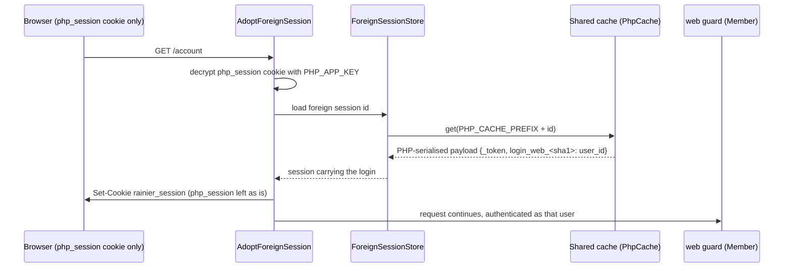

# compat-php: running beside a PHP application

> **Status:** STABLE
> **Owners (code):** `src/bootstrap.rs:354-382`, `src/app/http/kernel.rs:132-199`, `src/config/services.rs` (`php_*`)
> **Related docs:** [add-ins.md](add-ins.md), [cache-and-sessions.md](cache-and-sessions.md); framework: [compat], [scenarios]
> **Last verified against code:** 2026-11-06 @ `741ad28`

[compat]: https://github.com/safewords/rainier-framework/blob/main/docs/compat.md
[scenarios]: https://github.com/safewords/rainier-framework/blob/main/docs/scenarios.md

## Overview

This is for migrating routes away from a PHP application one at a time while
both apps serve the same domain. A browser that signed in on the PHP side
arrives with only the PHP session cookie, and Rainier accepts it as signed in.
CSRF tokens the PHP side issued are accepted too. The cargo feature
`compat-php` implies `accounts` and is left out of `add-ins`
(`Cargo.toml:121-125`). With the feature on and `PHP_APP_KEY` empty, nothing
changes at runtime.

## How it works today

### Interfaces

| Piece | What it does | Source |
|---|---|---|
| `kernel::php_keys` | parses `PHP_APP_KEY` (with or without the `base64:` prefix) into a `KeyRing`, and logs an error and disables compat on a bad key | `kernel.rs:162-170` |
| `AdoptForeignSession` (global) | when the request has the PHP cookie and no Rainier session, gives it a Rainier session carrying the same login; the PHP cookie is left untouched | `kernel.rs:188-199`, `bootstrap.rs:253-254` |
| `ForeignSessionStore` | wraps the configured session store, and reads a PHP session through `CacheSessionSource` over `PhpCache` once | `bootstrap.rs:357-380` |
| `EncryptedXsrf` CSRF codec | makes `VerifyCsrfToken` accept the PHP side's encrypted `XSRF-TOKEN` | `kernel.rs:138-144` |

| Env | Default | Notes |
|---|---|---|
| `PHP_APP_KEY` | empty (off) | the PHP side's `APP_KEY`; it is a secret, so set it from its Kubernetes Secret |
| `PHP_SESSION_COOKIE` | `php_session` | the PHP session cookie's name |
| `PHP_CACHE_PREFIX` | empty | the PHP cache prefix, prepended to the session id |
| `SESSION_COOKIE` | `rainier_session` | the cookie adopted sessions are moved to |

### Flow

The feature test builds a PHP-serialised payload with the guard key
`login_web_<sha1>` and the user id, puts it in the cache, seals the id into
the PHP cookie, and checks that `/account` returns the member
(`tests/addins.rs:710-760`).

### Edge cases & gotchas

- **PHP sessions are read from Rainier's *default* cache store**
  (`bootstrap.rs:367-370`). The PHP side has to keep its sessions in the same
  Redis, and `CACHE_STORE` has to point at that store. A PHP application
  using file or database sessions will not work here.
- **The login is copied once.** Afterwards the session lives in Rainier's own
  store, so a PHP logout does not end the Rainier session.
- **The member has to exist in `users`.** The adopted login carries a user
  id, and `AccountStore` has to find that row.
- **PHP password hashes** (`$2y$`) need the `bcrypt` feature and
  `HASH_DRIVER=bcrypt`. That is a separate feature, not part of `compat-php`.

## History & references

- README "Add-ins" (`compat-php` row). The framework's [compat] doc covers the wire formats.

## Proposed / Ideas (backlog)

| Idea | Motivation | Sketch | Status |
|---|---|---|---|
| A separate store for PHP sessions | The default cache store is not always where PHP keeps its sessions | `PHP_SESSION_STORE` naming a declared cache store | Open |
