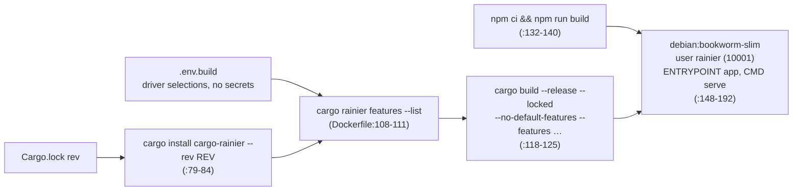

# Docker image and CI matrix

> **Status:** PARTIAL — the image builds and serves; its healthcheck probes the wrong thing, and the CI matrix leaves most driver features unbuilt
> **Owners (code):** `Dockerfile`, `.dockerignore`, `.github/workflows/ci.yml`, `.github/actions/system-deps/action.yml`, `.githooks/pre-commit`
> **Related docs:** [boot-and-configuration.md](boot-and-configuration.md) (feature sizing); framework: [deployment]
> **Last verified against code:** 2026-11-06 @ `fd84ed4` (CI run on `741ad28`: success)

[deployment]: https://github.com/safewords/rainier-framework/blob/main/docs/deployment.md

## Overview

The image has three stages: a Rust builder sized by `.env.build`, a Node
stage that compiles the Vite bundle, and a slim Debian runtime that runs as
an unprivileged user. CI runs on every push to `main`, except pushes that only
touch `docs/**` or `*.md` (`paths-ignore`, `ci.yml:5-9`). It also runs every
Monday at 07:00, which catches changes in the framework's `main` that would
otherwise produce no commit here (`ci.yml:3-14`). Nothing is deployed and no
image is pushed.

## How it works today

### Image

| Stage | Details | Source |
|---|---|---|
| builder | `rust:1.99.1-bookworm`, mold linker; installs `cargo-rainier` at the framework rev read from `Cargo.lock`; `ARG ENV_FILE=.env.build` (required, so a missing file fails the build); `ARG ADDINS` appends `RAINIER_ADDINS`; stripped binary | `Dockerfile:25-125` |
| assets | `node:22-bookworm-slim`, `npm ci`, `npm run build` | `Dockerfile:132-140` |
| runtime | `ca-certificates` only; copies `app`, `resources/`, `public/build`; creates `storage/{logs,mail,app}` and `/data`; `SERVER_HOST=0.0.0.0`, `SERVER_PORT=8000`, `APP_ENV=production`; `EXPOSE 8000` | `Dockerfile:148-192` |
| healthcheck | `app route:list` every 30 s | `Dockerfile:188-189` |

`.env.build` is the only file where `CACHE_DRIVER`, `QUEUE_DRIVER` and
`STORAGE_DRIVER` should appear. It never reaches the runtime stage, where the
first two would stop the boot (`Dockerfile:36-72`).

### CI jobs

| Job | What it proves | Source |
|---|---|---|
| `check` | `cargo fmt --all` (**commits the formatting itself on `main`**, fails anywhere else); `cargo clippy --all-targets -D warnings` | `ci.yml:34-77` |
| `test (matrix)` | per entry: clippy, `npm ci && npm run build`, `cargo test <flags>` | `ci.yml:79-137` |
| `migrations` | on a SQLite file: `migrate`, then `migrate:rollback` must refuse (`0005` is irreversible), then `migrate` again reports "Nothing to migrate" | `ci.yml:139-178` |
| `routes` | `cargo run -- route:list` boots | `ci.yml:180-199` |
| `docker` | builds with `.env.build = CACHE_DRIVER=memory, MAIL_DRIVER=log`, runs it with a random `APP_KEY`, and polls `/health` for up to 30 s | `ci.yml:201-252` |

Matrix entries (`ci.yml:85-94`): `default`, `redis`, `redis-cluster`,
`memcached`, `add-ins`, `compat-php`.

`system-deps` installs `build-essential cmake pkg-config zstd` on the bare ARC
runner, and skips the install when they are already present. The pre-commit
hook (enabled with `core.hooksPath=.githooks`) runs the same fmt and clippy
gate. It skips commits that touch no `.rs`, `Cargo.*` or `rustfmt.toml` file
(`.githooks/pre-commit:1-30`).

### Configuration

Run it with `docker run -e APP_KEY=… -e DATABASE_URL=… image`. Secrets are
passed at run time and never go into `.env.build`.

### Edge cases & gotchas

- **The healthcheck runs `route:list`, not `/health`.** The comment just
  above it says the probe should be `/health`, a plain 200 with no database
  behind it (`Dockerfile:183-189`). `route:list` boots the whole
  application every 30 s: it connects to the database, builds every cache
  store and runs pending migrations (`app_provider.rs:65-87`). It never
  checks that `serve` is answering, so a wedged server stays "healthy" and a
  database outage marks a working server unhealthy. The runtime image has no
  `curl`, which is presumably why.
- **The matrix skips most driver features.** `sqs`, `kafka`, `kafka-tls`,
  `s3`, `bcrypt`, `jwt`, `http-client` and all six `mail-*` are never
  compiled in CI, so a bad forward would not show up.
- **`check` pushes to `main` itself** (`style: cargo fmt [skip ci]`), so
  after a push it is worth pulling before the next commit.
- **Node 20 in CI and Node 22 in the image.**

## History & references

- `ci.yml:112-123`: why the cache matrix survived the removal of the per-driver arms.
- `README.md`: "Sizing the binary".

## Proposed / Ideas (backlog)

| Idea | Motivation | Sketch | Status |
|---|---|---|---|
| A real liveness probe | `route:list` boots and migrates every 30 s | A tiny `app health` command doing `GET /health` on localhost, or install `curl` | Open |
| Build the remaining features | Catch bad forwards | Add `sqs`, `s3`, `bcrypt`, `jwt`, `http-client`, `mail-smtp` to the matrix | Open |
