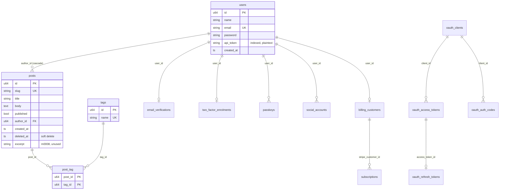

# Models and migrations

> **Status:** PARTIAL — the schema works; the search index and `excerpt` column are created and never used
> **Owners (code):** `src/app/models/`, `src/app/repositories/`, `src/database/migrations/`, `src/database/seeders.rs`
> **Related docs:** [add-ins.md](add-ins.md) (the add-in tables), [console-commands.md](console-commands.md) (`migrate`, `app:seed`); framework: [models], [relationships], [repositories], [migrations], [database], [pagination]
> **Last verified against code:** 2026-11-06 @ `fd84ed4`

[models]: https://github.com/safewords/rainier-framework/blob/main/docs/models.md
[relationships]: https://github.com/safewords/rainier-framework/blob/main/docs/relationships.md
[repositories]: https://github.com/safewords/rainier-framework/blob/main/docs/repositories.md
[migrations]: https://github.com/safewords/rainier-framework/blob/main/docs/migrations.md
[database]: https://github.com/safewords/rainier-framework/blob/main/docs/database.md
[pagination]: https://github.com/safewords/rainier-framework/blob/main/docs/pagination.md

## Overview

There are four domain entities (`User`, `Post`, `Tag`, `PostTag`), plus the
add-ins' state tables. Every one is a `#[derive(Entity)]` struct, and most
tables are created straight from the entity's metadata
(`Step::create_table::<M>`). Migrations are modules listed in order in
`database/migrations/mod.rs:75-107`. Nothing is discovered from timestamps.
All 18 numbered migrations run in every build, including the add-in tables,
so switching an add-in on never needs a schema change (`Cargo.toml:91-94`).

## How it works today

### Data model

| Model | Table | Key points | Source |
|---|---|---|---|
| `User` | `users` | `password` and `api_token` are `#[serde(skip)]`. `Authenticatable`; `Notifiable` sends mail to `email`. `User::posts()` is `HasMany` | `models/user.rs:9-104` |
| `Post` | `posts` | route key `slug`; `#[orm(soft_delete)] deleted_at`; indexes `(published, created_at)`, `(author_id, deleted_at)`, `author_id`; FK to `users(id)` with cascade. `author()` is `BelongsTo`, `tags()` is `BelongsToMany("post_tag")` | `models/post.rs:38-133` |
| `PostPublished` | (event) | `Broadcastable` on public `posts` as `post.published` with `{slug,title}` | `models/post.rs:139-179` |
| `Tag` | `tags` | route key `name`; `Tag::named` trims and lowercases | `models/tag.rs:10-44` |
| `PostTag` | `post_tag` | composite primary key, no auto-increment | `models/post_tag.rs:39-56` |
| `Member` | (view) | a `User` plus `email_verified_at` and `stripe_customer_id`, loaded by `AccountStore` | `models/member.rs:29-39` |
| add-in state | `email_verifications` … `subscriptions` | primary key or FK on `users(id)` with cascade | `models/account_state.rs:26-157` |
| OAuth | `oauth_clients`, `oauth_access_tokens`, `oauth_refresh_tokens`, `oauth_auth_codes` | string primary keys | `models/oauth.rs:17-130` |

Framework components bring their own tables, merged in after the numbered
migrations: `DatabaseChannel` (`notifications`) and `DatabaseQueue` (jobs
and failed jobs) (`migrations/mod.rs:98-103`). The session table is left
commented out (`migrations/mod.rs:104-106`).

### Migrations

| # | Kind | What it shows |
|---|---|---|
| 0001, 0002, 0006 | `create_table::<M>` | table, uniques, FK and soft-delete column all from the model |
| 0003 | `Step::table` builder | an index with a derived `down` (`m0003_index_posts_author.rs:14-18`) |
| 0004 | per-dialect closures | GIN on Postgres, an FTS5 virtual table on SQLite, FULLTEXT on MySQL (`m0004_add_post_search.rs:35-58`) |
| 0005 | `raw_irreversible` | lowercase emails. Rollback refuses with a reason (`m0005_normalise_emails.rs:24-34`) |
| 0007 | pivot | two keys, no auto-increment |
| 0008 | alter | nullable `excerpt` plus index `(author_id, created_at)` (`m0008_posts_add_excerpt.rs:15-22`) |
| 0009-0018 | `create_table::<M>` | add-in tables |

Tests in `migrations/mod.rs:109-196` pin the order and the module-to-name
mapping, and check that only `0005` is irreversible.

### Repositories

| Repository | Named queries | Source |
|---|---|---|
| `PostRepository` | `published_page`, `published_by_slug`, `for_author`, `publish` (conditional single-column update), `trash`, `restore`, `trashed_for_author`, `create_unique` (slug `-2`, `-3`, …, counting trashed rows) | `repositories/post_repository.rs:57-235` |
| `UserRepository` | `by_email` | `repositories/user_repository.rs:21-23` |
| `TagRepository` | `attach`, `cloud` (counts only reachable posts) | `repositories/tag_repository.rs:46-81` |
| `AccountStore`, `DatabaseOAuthStore`, `SubscriptionRepository` | add-in ports | [add-ins.md](add-ins.md) |

All of them `Deref` to `EntityRepository<M>`, so `find`, `create` and
`paginate_matching` stay available.

### Flow

Pending migrations run when the app boots ([boot-and-configuration.md](boot-and-configuration.md)).
`migrate`, `migrate --pretend` and `migrate:rollback` skip that, so the
command does the work itself (`app_provider.rs:59-67`). Seeding is idempotent:
it creates `ada@example.com` through `register_user`, which hashes the
password and sends `WelcomeMail`. It then adds three posts, two of them
published, and skips any title that already exists (`seeders.rs:16-48`).

### Edge cases & gotchas

- **A model change alters an already-numbered migration.** `create_table::<Post>`
  renders whatever `Post` says today. A column on the model must not also be
  added by an alter. One that is not on the model goes in its own alter, as
  `excerpt` does (`m0002_create_posts.rs:7-44`). An existing database gets no
  new column from a model change, and nothing reports that.
- **Search ignores the index it built.** `0004` creates a full-text index on
  each dialect. On SQLite that is an FTS5 table that nothing populates.
  `published_page` only does `title LIKE '%term%'`
  (`post_repository.rs:71-73`).
- **Redundant indexes on `posts.author_id`.** `idx_posts_author_id` (model),
  `posts_author_id_index` (`m0003`), plus two composites that both lead with
  `author_id`.
- **`create_unique` has a race.** It checks then inserts
  (`post_repository.rs:225-234`). Two concurrent posts with the same title
  can both pass the check, and the second hits the unique index and returns 500.
- `migrations/mod.rs:14` still calls `m0003` "raw SQL".

## History & references

- `m0002_create_posts.rs:18-43`: the cost of deriving a table from a model.
- Tests: `tests/feature.rs:303-422`, `:1053-1330` (relationships, soft delete, tags).

## Proposed / Ideas (backlog)

| Idea | Motivation | Sketch | Status |
|---|---|---|---|
| Use or drop the full-text index | Dead index; body not searched | Per-dialect `MATCH` / `to_tsvector` in `published_page`, or delete `0004` | Open |
| Drop `m0003` or the model's `#[orm(index)]` | Duplicate index | New migration dropping `posts_author_id_index` | Open |
