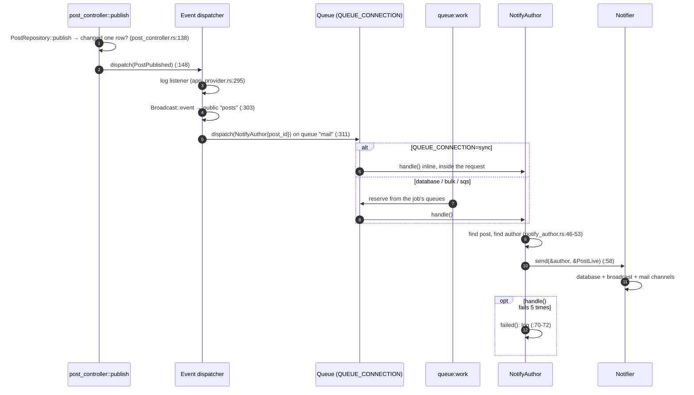

# Events, queues, jobs and the schedule

> **Status:** STABLE
> **Owners (code):** `src/config/queue.rs`, `src/bootstrap.rs` (`JobRegistry`), `src/app/jobs/`, `src/app/providers/app_provider.rs` (`EventServiceProvider`), `src/routes/console.rs` (`schedule`), `src/config/kafka.rs`
> **Related docs:** [mail-and-notifications.md](mail-and-notifications.md), [realtime.md](realtime.md), [console-commands.md](console-commands.md); framework: [events], [queues], [scheduling], [kafka]
> **Last verified against code:** 2026-11-06 @ `fd84ed4`

[events]: https://github.com/safewords/rainier-framework/blob/main/docs/events.md
[queues]: https://github.com/safewords/rainier-framework/blob/main/docs/queues.md
[scheduling]: https://github.com/safewords/rainier-framework/blob/main/docs/scheduling.md
[kafka]: https://github.com/safewords/rainier-framework/blob/main/docs/kafka.md

## Overview

Publishing a post sets off a chain. The `PostPublished` event (a fact) has
listeners. One of them dispatches the `NotifyAuthor` job. The job sends the
`PostLive` notification (a message to a person), and that goes out over
database, broadcast and mail. The sample has one job, three scheduled tasks,
and queue connections declared in `config/queue.rs`. The framework builds the
connections from that section ([queues]).

## How it works today

### Data model

`jobs` and `failed_jobs` come from `DatabaseQueue::migrations()`, merged into
every build (`migrations/mod.rs:99-103`). They stay empty unless a
`database` connection is used.

### Interfaces

| Kind | Name | Details | Source |
|---|---|---|---|
| Connection | `sync` (default) | runs a job inside the dispatching request | `config/queue.rs:103-108` |
| Connection | `database` | 90 s reservation | `config/queue.rs:116` |
| Connection | `bulk` | the same driver, 20 min reservation, drained by its own workers | `config/queue.rs:127` |
| Connection | `sqs` | only when `SQS_QUEUE_URL` is set: 5 min visibility, 20 s long poll, optional `AWS_REGION`/`SQS_ENDPOINT`; needs feature `sqs` | `config/queue.rs:133-157` |
| Job | `NotifyAuthor { post_id }` | `NAME = "app.notify-author"`, `QUEUE = "mail"`, `TRIES = 5`; does nothing if the post or author is gone; `failed` logs | `jobs/notify_author.rs:20-73` |
| Event | `PostPublished` | four listeners: log, broadcast, queue `NotifyAuthor`, and (`notify-discord`) a Discord announcement | `app_provider.rs:291-342` |
| Schedule | `sessions:prune` | hourly, without overlapping (30 min) | `routes/console.rs:41-60` |
| Schedule | `queue:reclaim` | every five minutes; reclaims jobs whose reservation expired | `routes/console.rs:64-81` |
| Schedule | `mail:weekly-digest` | Mondays 09:00, `on_one_server`; a placeholder that only logs | `routes/console.rs:89-98` |
| Env | `QUEUE_CONNECTION`, `QUEUE_DEFAULT`, `SQS_QUEUE_URL`, `SQS_ENDPOINT`, `AWS_REGION` | | `config/queue.rs:88-174` |

### Flow

The registry is given to the builder through `with_jobs`, not in a provider.
Providers register after the queue has been built, so a registry handed over
there would never reach the queue (`bootstrap.rs:163-186`,
`app_provider.rs:253-281`). In `Mode::Testing` a `MemoryQueue` takes the
place of the section, so a test can check what was queued and then drive a
worker itself (`bootstrap.rs:180-182`, `tests/feature.rs:442-487`).

With no `--queue` flag, `queue:work` drains the queues that this binary has
jobs registered for, `mail` included. The framework works this out from the
registry ([queues]).

### Configuration

| Variable | Default | Effect |
|---|---|---|
| `QUEUE_CONNECTION` | `sync` | default connection |
| `QUEUE_DEFAULT` | `default` | default queue name |
| `SQS_QUEUE_URL` | unset | declares `sqs` |
| `KAFKA_*` | see `.env.example` | written into framework keys by `config/kafka.rs:16-31`; no queue connection is declared |

### Edge cases & gotchas

- **`sync` is the default.** A failing job fails the request that
  dispatched it. Production should use `database` or `sqs`, plus a
  `queue:work` process.
- **No Kafka queue connection, on purpose.** `KafkaConnection` has no fields
  for TLS, SASL or credentials, so declaring one would connect in the clear
  and without authentication (`config/queue.rs:158-169`). The `kafka`
  features compile the client, and nothing in this application uses it.
- **`QUEUE_DRIVER` in `.env` stops the boot.** Only `.env.build` should spell it.
- **The README is stale here.** It says the default is `MemoryQueue` and
  tells you to switch to `DatabaseQueue` in `app_provider.rs`
  (`README.md:111-114`). Its "Adding things" table puts the `JobRegistry`
  in `app_provider.rs` (`README.md:161`). `jobs/mod.rs:3-4` names a
  `queue_provider.rs` that does not exist. The registry is at
  `bootstrap.rs:172`.
- **`sessions:prune` runs whatever the session driver is.** It constructs a
  `DatabaseSessionStore` itself (`routes/console.rs:44-55`). The sessions
  table is never migrated, because the merge is commented out
  (`migrations/mod.rs:104-106`). So under `schedule:run` the task fails
  every hour unless somebody has enabled database sessions. `queue:reclaim`
  does the same with `DatabaseQueue`, but its tables are always created, so
  it does no harm.

## History & references

- `app_provider.rs:253-281`: why the queue is no longer built in a provider (jobs ran inline while everyone believed they were queued).
- `app/notifications/mod.rs:1-36`: events compared with notifications.
- Tests: `tests/feature.rs:442-650`, `routes/console.rs:101-182`.

## Proposed / Ideas (backlog)

| Idea | Motivation | Sketch | Status |
|---|---|---|---|
| Fix the README and `jobs/mod.rs` | They point to code that no longer exists | Point at `bootstrap.rs:172` and `QUEUE_CONNECTION` | Open |
| Register `sessions:prune` only for `SESSION_DRIVER=database` | It fails hourly against a missing table | Check the driver in `schedule()` | Open |
