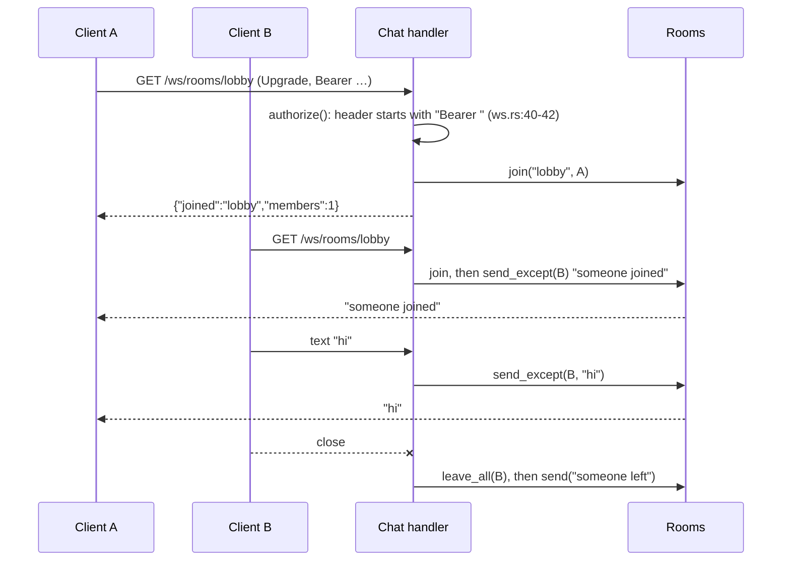

# Broadcasting and WebSockets

> **Status:** PARTIAL — the WebSocket room accepts any bearer string without checking it, and Running-mode broadcasts only go to the log
> **Owners (code):** `src/routes/ws.rs`, `src/routes/channels.rs`, `src/app/providers/app_provider.rs` (`broadcasting`), `src/app/models/post.rs` (`PostPublished`), `src/bootstrap.rs:48-50`, `:241-245`
> **Related docs:** [queues-and-jobs.md](queues-and-jobs.md), [mail-and-notifications.md](mail-and-notifications.md); framework: [broadcasting], [websockets]
> **Last verified against code:** 2026-11-06 @ `741ad28`

[broadcasting]: https://github.com/safewords/rainier-framework/blob/main/docs/broadcasting.md
[websockets]: https://github.com/safewords/rainier-framework/blob/main/docs/websockets.md

## Overview

There are two separate mechanisms. **Broadcasting** pushes events onto named
channels for an external socket server (soketi or Pusher style). The
`channels.rs` table decides who may subscribe to a private channel, and
`POST /api/broadcasting/auth` signs the subscription. **WebSockets** are held
by this process, on the HTTP port: `/ws/rooms/{room}` is a chat room whose
members hear each other.

## How it works today

### Interfaces

| Kind | Name / path | Auth | Handler | Notes |
|---|---|---|---|---|
| Broadcast | public `posts`, event `post.published` | none | `PostPublished::broadcast_*` (`post.rs:151-179`) | payload `{slug, title}` |
| Broadcast | the recipient's notification channel | the user | `authorize_notifications(&mut channels, "User", …)` (`channels.rs:42`) | carries `PostLive` |
| Channel rule | `posts.{post}` | the author of that post | `channels.rs:47-63` | a missing post is denied, not an error |
| HTTP | `POST /api/broadcasting/auth` | `api` guard | `broadcasting::authorize::<User>` (`api.rs:111-116`) | fails closed: an undeclared channel is denied |
| WebSocket | `GET /ws/rooms/{room}` | `Authorization: Bearer …` present | `Chat` (`ws.rs:16-82`) | join, leave and text relay; binary frames get "this room speaks text" |

### Flow

`Rooms` is a single shared registry. It is bound in the container
(`bootstrap.rs:50`, `:244-245`), so an ordinary HTTP controller can push into
a room.

The broadcaster depends on the mode. Testing binds a `MemoryBroadcaster` so
tests can read what was published. Running uses `Broadcasting::log()`
(`app_provider.rs:203-218`).

### Configuration

None of its own. Going live means swapping in `RedisBroadcaster::connect(..)`
through `Rainier::with_broadcasting` in `bootstrap.rs`, with soketi pointed
at the same Redis (`app_provider.rs:212-216`).

### Edge cases & gotchas

- **The WebSocket token is never validated.** `authorize` only checks that
  `Authorization` starts with `"Bearer "` (`ws.rs:40-42`). The doc comment
  and the README (`README.md:124-125`) say "only signed-in callers", but
  `Bearer x` is accepted. This handler is template code, so services cloned
  from the sample start out with the same check. A fix is to resolve
  `AuthManager<User>` and authenticate the request in `authorize`, or in
  `on_connect` if the trait needs async. No test covers `/ws` at all.
- **Production broadcasts reach nobody.** The log broadcaster is the Running
  default. Channel authorisation works, but nothing is ever published to a
  socket server.
- **Rooms live in one process.** With more than one replica, members on
  different replicas cannot hear each other.
- **Per-session channels don't belong in `channels.rs`.** Every rule there
  answers "may this *user* subscribe", so each of the user's devices gets
  the channel (`channels.rs:15-27`).

## History & references

- Tests: `tests/feature.rs:624-725` (broadcast and channel auth). Nothing tests WebSockets.

## Proposed / Ideas (backlog)

| Idea | Motivation | Sketch | Status |
|---|---|---|---|
| Authenticate the socket for real | Auth bypass in the template | Resolve the `api` guard in `authorize` and reject an unknown token with 403; add a feature test | Open (High) |
