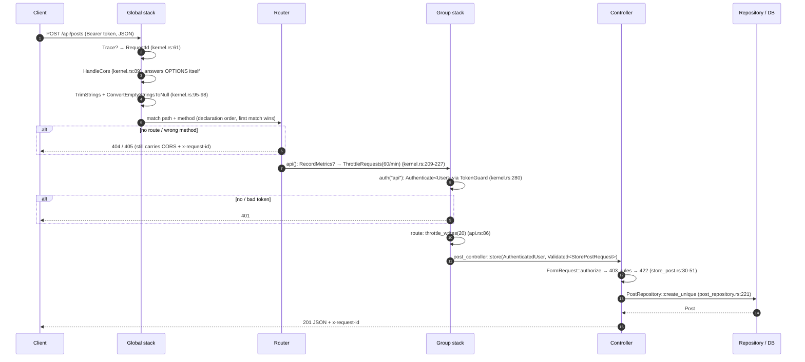

# Routes, middleware and controllers

> **Status:** STABLE
> **Owners (code):** `src/routes/web.rs`, `src/routes/api.rs`, `src/routes/openapi.rs`, `src/app/http/kernel.rs`, `src/app/http/middleware/`, `src/app/http/controllers/`, `src/app/http/requests/`
> **Related docs:** [auth.md](auth.md), [add-ins.md](add-ins.md) (the `/account`, `/billing`, `/oauth` routes), [realtime.md](realtime.md) (`/ws`, `/api/broadcasting/auth`); framework: [routing], [middleware], [controllers], [requests], [validation], [responses]
> **Last verified against code:** 2026-11-06 @ `fd84ed4`

[routing]: https://github.com/safewords/rainier-framework/blob/main/docs/routing.md
[middleware]: https://github.com/safewords/rainier-framework/blob/main/docs/middleware.md
[controllers]: https://github.com/safewords/rainier-framework/blob/main/docs/controllers.md
[requests]: https://github.com/safewords/rainier-framework/blob/main/docs/requests.md
[validation]: https://github.com/safewords/rainier-framework/blob/main/docs/validation.md
[responses]: https://github.com/safewords/rainier-framework/blob/main/docs/responses.md

## Overview

The HTTP surface of the sample has three parts. A few browser routes
(`/`, `/health`, `/login`, `/visits`). A JSON API under `/api` for posts, the
current user and notifications. A generated OpenAPI document. The kernel is
not a map of names. It is a set of functions that return `MiddlewareStack`
values, so a misspelt group fails to compile instead of leaving a route
unguarded (`kernel.rs:1-28`).

## How it works today

### Middleware

| Layer | Middleware | Source |
|---|---|---|
| global (wraps the router) | `Trace` (when telemetry is configured), `RequestId`, `HandleCors`, `TrimStrings` (except `password`, `password_confirmation`, `body`), `ConvertEmptyStringsToNull` | `kernel.rs:51-99` |
| global, `compat-php` with `PHP_APP_KEY` | `AdoptForeignSession` | `kernel.rs:188-199`, `bootstrap.rs:253-254` |
| `kernel::web()` | the framework's `groups::web()`: security headers and `StartSession` | `kernel.rs:112-114` |
| `kernel::api(metrics)` | `RecordMetrics` (when metrics are on), `ThrottleRequests::per_minute(60)` | `kernel.rs:209-227` |
| `kernel::auth(guard)` | `Authenticate::<User>` on the named guard | `kernel.rs:280-282` |
| `kernel::throttle_writes(n)` | a tighter per-route limit | `kernel.rs:285-287` |
| `kernel::browser`, `kernel::web_auth` | `web()` plus CSRF, and the `web` session guard (feature `accounts`) | `kernel.rs:132-159` |

`kernel::secure_headers()` (`kernel.rs:290-292`) is defined and never used.

CORS is global on purpose. A browser preflight is an `OPTIONS` request, and no
route accepts `OPTIONS`. The router would answer `405` before any
group middleware ran (`kernel.rs:62-89`). The origin list comes from
`config/cors.rs`: two hard-coded production origins, two Vite dev origins,
and anything in `CORS_ALLOWED_ORIGINS`. A `*` entry is refused with a warning,
because the policy sends credentials (`config/cors.rs:82-146`). Allowed
request headers are `content-type`, `authorization` and `x-requested-with`
(`config/cors.rs:100`).

`RequestIdMiddleware` keeps an incoming `x-request-id` when it is 1-64 chars of
`[A-Za-z0-9_-]`, and otherwise generates `<pid hex>-<counter hex>`. It stores
the id as a request extension and echoes it on the response
(`middleware/request_id.rs:29-62`).

### Request lifecycle

A `web` route adds security headers and the session in place of the throttle
and token guard. For an `/account` route under `accounts`, CSRF and
`Authenticate::<Member>("web")` come next.

### Interfaces

| Method | Path | Name | Middleware (beyond global) | Handler | Notes |
|---|---|---|---|---|---|
| GET | `/` | `home` | none | `home_controller::index` (`:10`) | renders `home` with five published posts |
| GET | `/health` | `health` | none | `home_controller::health` (`:25`) | `{"status":"ok"}`, no I/O |
| GET | `/health/version` | `health.version` | none | `home_controller::version` (`:38`) | `build_info!()`, commit from `GITHUB_SHA`/`GIT_SHA` |
| POST | `/login` | `login` | web, throttle 10/min | `auth_controller::login` (`:14`) | see [auth.md](auth.md) |
| GET | `/visits` | `visits` | web | `home_controller::visits` (`:46`) | session counter, flash, CSRF token |
| GET | `/api/metrics` | `api.metrics` | api | framework `metrics_endpoint` | 404 unless `METRICS_ENABLED` |
| GET | `/api/openapi.json` | `api.openapi` | api | framework `openapi_endpoint` | 404 unless `OPENAPI_ENABLED` |
| GET | `/api/posts` | `api.posts.index` | api | `post_controller::index` (`:22`) | `page`, `per_page` (1-100), `search` (≤100), `tag` (≤50) |
| GET | `/api/posts/trashed` | `api.posts.trashed` | api, auth | `post_controller::trashed` (`:168`) | must come before `/posts/{post}` (`api.rs:53-67`) |
| GET | `/api/posts/{post}` | `api.posts.show` | api, slug constraint | `post_controller::show` (`:94`) | a draft returns 404 |
| GET | `/api/me` | `api.me` | api, auth | `auth_controller::me` (`:49`) | |
| POST | `/api/logout` | `api.logout` | api, auth | `auth_controller::logout` (`:35`) | 204 |
| POST | `/api/posts` | `api.posts.store` | api, auth, throttle 20/min | `post_controller::store` (`:103`) | 201, draft |
| POST | `/api/posts/{post}/publish` | `api.posts.publish` | api, auth | `post_controller::publish` (`:120`) | policy `posts.publish`, raises `PostPublished` |
| DELETE | `/api/posts/{post}` | `api.posts.destroy` | api, auth | `post_controller::destroy` (`:157`) | soft delete, 204 |
| POST | `/api/posts/{post}/restore` | `api.posts.restore` | api, auth | `post_controller::restore` (`:184`) | only your own binned post |
| POST | `/api/broadcasting/auth` | `api.broadcasting.auth` | api, auth | framework `broadcasting::authorize::<User>` | [realtime.md](realtime.md) |
| GET | `/api/notifications` | `api.notifications.index` | api, auth | `notification_controller::index` (`:21`) | `unread`, `limit` (1-100, default 20) |
| POST | `/api/notifications/read` | `api.notifications.read-all` | api, auth | `notification_controller::read_all` (`:62`) | |
| POST | `/api/notifications/{notification}/read` | `api.notifications.read` | api, auth | `notification_controller::read` (`:45`) | scoped to the recipient, 404 otherwise |
| GET | `/{file}` under `public/` | none | none | the framework's static handler | traversal-safe, no dotfiles (`tests/feature.rs:1333-1390`) |

Web routes are declared before API routes so that `/` matches first
(`bootstrap.rs:259-268`). Add-in routes come after both.

### Flow

- **Index.** An unknown `tag` short-circuits to an empty page
  (`post_controller.rs:30-36`). Otherwise `PostRepository::published_page`
  builds one `Criteria`: published only, newest first, `LIKE` on title, and
  an `EXISTS` on `post_tag` (`post_repository.rs:57-86`). Authors and tags are
  then loaded in two more queries, whatever the page size
  (`post_controller.rs:46-47`).
- **Publish.** Authorisation goes through the policy
  (`post_controller.rs:129`). Next comes a conditional
  `UPDATE … WHERE published = false` (`post_repository.rs:125-136`). The event
  is raised only when that update changed a row, so publishing twice notifies
  once (`post_controller.rs:138-148`).
- **Restore.** `Bound<Post>` cannot find a trashed row, so `restore` reads
  the raw `{post}` parameter and searches the caller's own bin. "Not yours"
  and "does not exist" both return 404 (`post_controller.rs:184-205`).
- **Request contracts.** `LoginRequest`, `ListPostsRequest`, `StorePostRequest`
  and `ListNotificationsRequest` (`requests/`). The query-string contracts
  override `validation_data` to read `request.query()`
  (`requests/login.rs:64-66`). `StorePostRequest::authorize` requires an
  authenticated user and has custom messages (`store_post.rs:40-50`).
- **Facade resolution.** Controllers resolve services through
  `post_controller::resolve`, a thin wrapper over
  `facade_application().resolve()` (`post_controller.rs:219-221`).

### Configuration

`CORS_ALLOWED_ORIGINS`, `METRICS_ENABLED`/`METRICS_PATH`,
`OPENAPI_ENABLED`/`OPENAPI_PATH`, `SERVER_REQUEST_TIMEOUT` (default 30 s),
`SERVER_COMPRESSION`. The OpenAPI document is assembled from route names and
each request contract's rules (`routes/openapi.rs:28-130`). It is rendered
once, after boot (`bootstrap.rs:284-289`).

### Edge cases & gotchas

- **Order matters.** `/api/posts/trashed` has to be declared before
  `/api/posts/{post}`, because `trashed` is a valid slug (`api.rs:53-67`).
- **`/api/metrics` and `/api/openapi.json` sit outside the guard**, which
  is a choice for a sample. A real deployment should protect them
  (`api.rs:38-42`).
- **Page size is hard-coded.** `ListPostsRequest` defaults to 15 and caps at
  100 in code (`requests/login.rs:46-56`). `POSTS_PER_PAGE` is set
  (`config/posts.rs:11`) and never read.
- **The dev origins are always allowed.** `localhost:5173` and `:4173` are on
  the credentialed CORS list in every environment (`config/cors.rs:90`).
- **`X-XSRF-TOKEN` is not an allowed CORS header**, so a cross-origin SPA
  cannot call the `/account` routes. The README's curl example is
  same-origin.
- `routes/mod.rs:5` still says `api` "gets CORS". It doesn't.

## History & references

- `kernel.rs:62-88`: why CORS moved from the `api` group to global.
- `routes/web.rs:12-24`: why the asset controller was deleted.
- Tests: `tests/feature.rs:769-890` (CORS, request id, 405, HTML/JSON errors).

## Proposed / Ideas (backlog)

| Idea | Motivation | Sketch | Status |
|---|---|---|---|
| Read `POSTS_PER_PAGE` in `ListPostsRequest` | The config key is dead | `default_per_page()` reads `Config::instance()` | Open |
| Only allow dev origins outside production | Credentialed CORS to localhost in prod | Gate `DEVELOPMENT_ORIGINS` on `APP_ENV` | Open |
